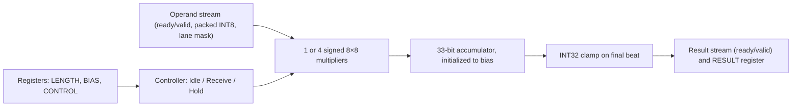

# EdgeMAC

EdgeMAC is a pre-silicon SystemVerilog block that computes a signed INT8 dot product with an INT32 bias:

```
result = clamp_int32(bias + Σ a[i] · w[i]),   1 ≤ N ≤ 1024,   a[i], w[i] ∈ [-128, 127]
```

The same RTL is built with one lane (one pair per cycle) or four lanes (four pairs per cycle). Software configures it through a small register interface. Operands arrive on a ready/valid stream, and the result leaves on a second ready/valid stream.

## Why saturation happens only once

The block clips to INT32 once, after the exact sum. Clipping after every beat gives a different answer whenever an intermediate sum crosses a bound and the final sum returns inside it. The directed simulation suite runs this case on both lane counts:

| | Value |
| --- | ---: |
| Bias | 2,147,483,647 (INT32 max) |
| Activations / weights | `[1, 0, 0, 0, -1]` / `[1, 1, 1, 1, 1]` |
| Four-lane beat 1 (lanes 0–3) adds | +1 → exact running total 2,147,483,648 |
| Four-lane beat 2 (lane 0 only, partial final beat) adds | −1 → exact total 2,147,483,647 |
| **EdgeMAC result (final-only saturation)** | **2,147,483,647** |
| Clipping after every beat would give | 2,147,483,646 |

To hold the exact sum, the running total is 33 bits wide. Over 1,024 products plus any INT32 bias, it spans [−2,164,129,792, 2,164,260,863]. [The specification](docs/specification.md) derives that range.

## Architecture



- **Start.** Software writes `VECTOR_LENGTH` and `BIAS`, then writes 1 to `CONTROL`. No operand is accepted on the start edge.
- **Operand stream.** The block accepts one beat per cycle while receiving. A beat carries `LANES` activation/weight pairs and a mask, which must be exactly the low `min(remaining, LANES)` bits. A partial final beat (for example 3 of 4 lanes) uses a shorter mask. Any other mask aborts the operation and sets an error bit, without producing a result.
- **Result stream.** The result is valid on the edge after the final beat is accepted. It is held stable, and the block stays busy, until `result_ready` acknowledges it. While the result is held, `in_ready` stays low, which is backpressure all the way to the operand producer.
- **Registers.** `RESULT` keeps the last completed result, so it stays readable while the next operation is being received, and through errors, until a later operation completes or reset clears it.

The [specification](docs/specification.md) has the full register map and error rules. The [microarchitecture notes](docs/microarchitecture.md) describe the datapath.

## Build and test

You need CPython 3.12 and the [OSS CAD Suite 2026-11-14](https://github.com/YosysHQ/oss-cad-suite-build/releases/tag/2026-11-14) release. The suite provides every required tool: `iverilog`, `vvp`, Verilator (`verilator`, or `verilator_bin` on Windows), `yosys` (with its bundled ABC), `sby`, `z3`, `bitwuzla`, and `nextpnr-ice40`. `python scripts/check.py env` reports any tool that is missing.

**Linux x64.** These commands mirror [the CI workflow](.github/workflows/regression.yml):

```sh
python3.12 -m venv .venv && . .venv/bin/activate
python -m pip install -r requirements-sim.txt
curl -fLO https://github.com/YosysHQ/oss-cad-suite-build/releases/download/2026-11-14/oss-cad-suite-linux-x64-20261114.tgz
echo "25d1960bc0f002c43b3579423c4e622bcffed49b7bb8b1f02df6426b1bdd2f26  oss-cad-suite-linux-x64-20261114.tgz" | sha256sum --check
tar -xzf oss-cad-suite-linux-x64-20261114.tgz -C "$HOME"
export PATH="$PATH:$HOME/oss-cad-suite/bin"   # appended, so the venv Python stays first
python scripts/check.py env
python scripts/check.py all
```

**Windows x64.** Extract the suite's Windows x64 archive, then load it into the current PowerShell session. The helper also enables a staged Icarus compile that avoids a driver crash described in [the environment notes](docs/environment.md).

```powershell
python -m pip install -r requirements-sim.txt
. ./scripts/use-windows-suite.ps1 -SuiteRoot 'C:/path/to/oss-cad-suite'
python scripts/check.py all
```

`check.py all` runs these checks in order: `env`, `oracle`, `smoke`, then `lint`, `sim`, `formal`, `synth`, `perf`, and `timing` for both lane counts. Any check can run alone, for example `python scripts/check.py formal --lanes 4`. Two follow-up commands run after it:

```sh
python scripts/check_mutations.py    # injects 6 RTL defects; each must be caught (2 also formally)
python scripts/export_evidence.py    # rewrites results/cycles.csv and results/hardware.json
```

Raw tool output, simulator results, and formal witness traces go under `build/`.

## One lane versus four lanes

The workload is one 1,024-element vector streamed with no input gaps. Both configurations use the same RTL, seed, and synthesis and placement settings.

| Metric | 1 lane | 4 lanes | Kind |
| --- | ---: | ---: | --- |
| Start-to-result cycles | 1,024 | 256 | Measured in simulation |
| Start-to-acknowledge cycles, no output stall | 1,025 | 257 | Measured in simulation |
| Yosys generic cells | 1,466 | 3,256 | Measured, tool count |
| iCE40 HX8K internal clock | 88.97 MHz | 71.75 MHz | Estimated by nextpnr |

The four-lane design finishes in about 4× fewer cycles, uses about 2.2× the generic cells, and has a slower estimated internal clock.

- **Cycles.** Cycles are counted from the edge that accepts the start write. The two configuration writes before it are excluded. An 8-cycle output stall adds exactly 8 cycles in both configurations. [`results/cycles.csv`](results/cycles.csv) has all 20 rows per configuration, covering 10 lengths and 2 stall settings.
- **Cells.** A generic cell count has no area units. The two configurations have the same 145 flip-flops.
- **Clock.** The clock is a placed-and-routed estimate for one device, at a 50 MHz target, with placement seed 1 and automatically placed I/O. No board was built. Physical-board bandwidth and timing were not measured, and no ASIC flow was run.

All four rows were reproduced on this source snapshot. `results/cycles.csv` and `results/hardware.json` were regenerated byte-for-byte identical to the committed files. [The hardware comparison](docs/hardware-comparison.md) has the full sweep and a throughput projection.

## What is verified, and how strongly

| Method | Scope |
| --- | --- |
| Python oracle unit tests | Hand-calculated fixtures, invalid inputs, seeded 1,024-element cancellation |
| cocotb simulation, both lane counts | Directed boundary and saturation cases. Every length from 1 to 1,024. 64 randomized transactions with gaps and stalls. 300 transactions with random register traffic and resets in every phase. |
| Formal protocol proof (SymbiYosys) | Unbounded PDR proof of the stream and register safety properties at the production 1,024-element limit and at 8 elements. Exact beat-count (bounded-response) properties are proven only at 8. |
| Formal arithmetic check | Bounded (10 steps), all INT8 operands and all INT32 biases, for fixed two-beat transactions of length 2 (1 lane) and 5 (4 lanes) |
| Synthesis and timing | Yosys generic mapping with `check -assert`. nextpnr iCE40 placement and routing as an estimate only. |
| Mutation checks | 6 injected RTL defects, each caught by simulation with its expected message. 2 of them are also refuted by formal counterexamples. |

[The verification results](docs/verification-results.md) give each task, depth, and outcome. [The verification plan](docs/verification-plan.md) maps requirements to checks.

## Limitations

- Formal arithmetic covers only two-beat transactions. Longer vectors are checked against the oracle in simulation, not proven.
- No LTL liveness proof was run. At 1,024 elements the exact beat count is checked by simulation, not by proof.
- The register interface is EdgeMAC-specific. Connecting it to APB or AXI needs an adapter.
- The FPGA clock figures are estimates. They use one device, one placement seed, and no board constraints.

[Known limitations](docs/limitations.md) has the complete list.

## Continuous integration

[`regression.yml`](.github/workflows/regression.yml) runs the full regression, the mutation checks, and evidence export on Ubuntu 24.04. It uses the pinned Linux suite, verified by SHA-256. [Run #3](https://github.com/TS-SL/edgemac-rtl/actions/runs/45017194230) passed on commit `f93502e`, the initial snapshot. The check script fails on any skipped or failing cocotb test and on any formal task that does not report PASS. See the [Actions page](https://github.com/TS-SL/edgemac-rtl/actions) for later revisions.

## Further reading

- [Specification: arithmetic, streams, and register map](docs/specification.md)
- [Microarchitecture](docs/microarchitecture.md)
- [Verification plan](docs/verification-plan.md) and [results](docs/verification-results.md)
- [One-lane versus four-lane comparison](docs/hardware-comparison.md)
- [Toolchain and environment](docs/environment.md)
- [Known limitations](docs/limitations.md)
- [Development conventions](CONTRIBUTING.md)

## License

MIT; see [LICENSE](LICENSE). The OSS CAD Suite and Python packages used to build and test the design are separate projects under their own licenses and are not redistributed here.
