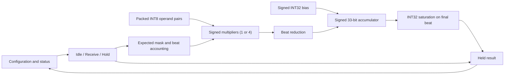

# EdgeMAC microarchitecture

The single-clock controller receives one legal beat per cycle. A valid four-lane beat reduces two product pairs and then adds the pair sums. The result register is both the stream holding register and the most recent result for configuration reads. When the result stream stalls, the controller remains busy and the accumulator stays idle.

For a vector of length N, the no-gap input beat count is ceil(N / LANES). The result becomes visible after the final accepted beat. A subsequent edge acknowledges it. Configuration writes and output stalls consume separate cycles. Compare measured operation cycles separately from accepted input beats.
